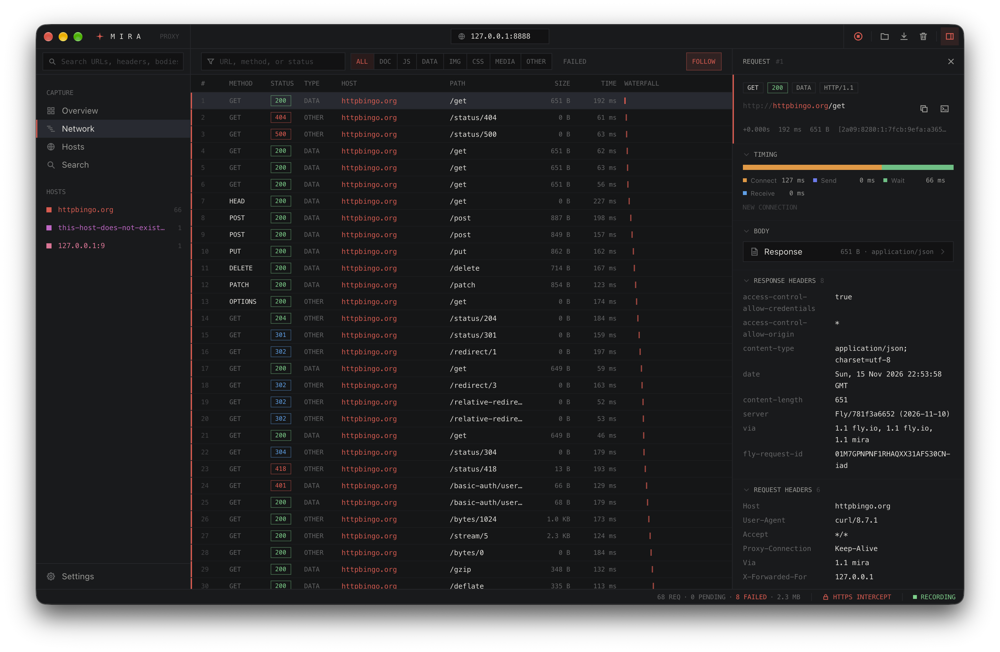

# Mira

<div align="center">

[](https://github.com/ry-sev/mira/actions)
[](https://github.com/ry-sev/mira/releases/latest)

</div>

A general-purpose HTTP/HTTPS proxy for inspecting, debugging, and monitoring web traffic.



## Documentation

- [Proxy Architecture](docs/proxy-architecture.md) - internals, request flows, and module layout
- [Certificate Installation](docs/certificate-installation.md) - trusting the CA on each platform
- [Installing Mira](docs/installing.md) - the desktop app's installers, and their first-run warnings
- [Releasing](docs/releasing.md) - building the installers and publishing a release
- [Example Configuration](docs/config.example.toml) - annotated config file

## Features

- **HTTP/1.1 Proxy** - Forward proxy for plain HTTP traffic
- **HTTPS Interception** - TLS termination with on-the-fly certificate generation
- **HTTP/2** - Intercepted TLS sessions that negotiate `h2` are served natively, with each stream forwarded upstream
- **HTTPS Tunneling** - CONNECT tunnel support for HTTPS passthrough
- **WebSocket Support** - Transparent WebSocket upgrade passthrough, over plain HTTP and intercepted HTTPS
- **Desktop App** - A GPUI window with a request table and waterfall, an inspector, body viewer, hosts, search, and settings
- **TUI Interface** - Terminal UI for real-time traffic inspection
- **Request/Response Capture** - Full body capture with chunked encoding support
- **Response Decompression** - Automatic gzip, deflate, and brotli decompression
- **Connection Pooling** - HTTP/1.1 keep-alive connection reuse
- **Host Filtering** - Include/exclude hosts with wildcard patterns
- **Timing Information** - Detailed timing breakdown (connect, ssl, send, wait, receive)
- **HAR Import/Export** - Export captured traffic to HAR 1.2, or load a HAR file back into the TUI
- **CA Download Page** - Visit `http://mira.proxy` through the proxy to grab the CA certificate
- **Bounded Capture** - Configurable limits on retained exchanges and body bytes
- **Security** - Blocks external IP connections by default (configurable)
- **Callback System** - Programmatic access to requests, responses, and exchanges

## Installation

The desktop app has installers for macOS, Windows and Linux on the
[releases page](https://github.com/ry-sev/mira/releases);
[Installing Mira](docs/installing.md) walks through them. To build from
source instead, which is also how to get the terminal UI:

```bash
# Clone the repository
git clone https://github.com/ry-sev/mira.git
cd mira

# Build release binaries
cargo build --release

# The desktop app is target/release/mira, the terminal UI target/release/mira-cli
```

On Linux, the desktop app needs GPUI's system libraries:

```bash
sudo apt-get install -y libfontconfig-dev libwayland-dev libxkbcommon-x11-dev libx11-xcb-dev libzstd-dev libvulkan1
```

## Usage

### Basic Usage

```bash
# Start proxy on default port 8888 (binds to 127.0.0.1)
mira-cli

# Start on a specific port
mira-cli --port 9000

# Bind to all interfaces, so other machines can use the proxy
mira-cli --bind 0.0.0.0

# Allow connections from external IPs (use with caution)
mira-cli --allow-external
```

### Command-Line Options

| Option                     | Description                                                                                           |
| -------------------------- | ----------------------------------------------------------------------------------------------------- |
| `-b, --bind <IP>`          | Address to bind to (default: `127.0.0.1`)                                                             |
| `-p, --port <PORT>`        | Port to listen on (default: `8888`)                                                                   |
| `-i, --intercept`          | Enable HTTPS interception (requires trusting the CA certificate)                                      |
| `--ca-dir <DIR>`           | Directory holding the CA certificate and key (default: `~/.mira`)                                     |
| `--passthrough <HOST>`     | Host to tunnel without interception (repeatable, wildcards OK)                                        |
| `--allow-external`         | Accept connections from public IP addresses                                                           |
| `--har [FILE]`             | Export captured traffic on exit (default: `<timestamp>.har`)                                          |
| `--load <FILE>`            | Load a HAR file into the session at startup                                                           |
| `-c, --config <FILE>`      | Path to a TOML config file                                                                            |
| `--no-config`              | Skip config file loading entirely                                                                     |
| `--dump-config`            | Print the effective configuration as TOML and exit                                                    |
| `--connect-timeout <SECS>` | Upstream connect timeout (default: `30`)                                                              |
| `--read-timeout <SECS>`    | Upstream read timeout (default: `60`)                                                                 |
| `--write-timeout <SECS>`   | Timeout for each write to an upstream or a client (default: `60`)                                     |
| `--max-body-size <MB>`     | Larger requests are rejected; larger responses are relayed but captured only in part (default: `500`) |
| `--max-header-size <KB>`   | Maximum request/response header block size (default: `64`)                                            |

### HAR Export and Import

```bash
# Export to auto-generated timestamp filename
mira-cli --har

# Export to a specific file
mira-cli --har traffic.har

# Load a previously captured HAR file into the TUI
mira-cli --load traffic.har

# Load a HAR, keep capturing, and write everything back out on exit
mira-cli --load traffic.har --har traffic.har
```

Both standard HAR files (from browsers or other proxies) and Mira-exported
HAR files with full-fidelity extension fields can be loaded. Loading applies
the same `[capture]` limits the proxy captures with, so a large HAR cannot
push the session past its memory budget; anything dropped is reported in the
log. The TUI keeps the same number of rows, dropping the oldest first.

Passthrough `CONNECT` tunnels and WebSocket upgrades are captured too. Each is
one exchange: the tunnel's `200`, or the origin's answer to the upgrade. The
traffic inside them is not.

### HTTPS Interception

Intercept and inspect HTTPS traffic by enabling TLS termination:

```bash
# Enable HTTPS interception
mira-cli --intercept

# Specify custom CA directory
mira-cli --intercept --ca-dir /path/to/certs

# Passthrough specific hosts without interception
mira-cli --intercept --passthrough "*.example.com" --passthrough "api.internal.com"
```

Intercepted sessions negotiate ALPN with the client. A client that asks for
`h2` gets an HTTP/2 session, and each of its streams is forwarded upstream
over the protocol the origin agreed to; anything else is served as HTTP/1.1.
Clients speak HTTP/1.1 to the proxy itself, since that is what carries
`CONNECT`.

**Note:** HTTPS interception requires installing and trusting Mira's CA certificate. With the proxy running, visit `http://mira.proxy` to download it, or see [Certificate Installation](docs/certificate-installation.md) for setup instructions.

### Configuration File

Mira supports TOML configuration files for persistent settings. Configuration is loaded from:

1. Explicit `--config <path>` argument
2. `$XDG_CONFIG_HOME/mira/config.toml` (usually `~/.config/mira/config.toml`)
3. `~/.mira/config.toml` (fallback)

```bash
# Use a specific config file
mira-cli --config /path/to/config.toml

# Disable automatic config file loading
mira-cli --no-config

# Print the effective configuration and exit (useful for debugging)
mira-cli --dump-config
```

See [docs/config.example.toml](docs/config.example.toml) for a complete example with all available options. CLI arguments override config file values.

### Configure Your Client

Set your HTTP client to use the proxy:

```bash
# Using curl
curl -x http://127.0.0.1:8888 http://example.com

# Using environment variables
export http_proxy=http://127.0.0.1:8888
export https_proxy=http://127.0.0.1:8888

# Using wget
wget -e use_proxy=yes -e http_proxy=127.0.0.1:8888 http://example.com
```

### Logging

The TUI owns the terminal, so logs are written to a daily-rolled file rather
than stdout. Each day gets its own file, named `mira-cli.log.YYYY-MM-DD`:

| Platform | Directory                                        |
| -------- | ------------------------------------------------ |
| Linux    | `$XDG_STATE_HOME/mira/` (`~/.local/state/mira/`) |
| macOS    | `~/Library/Logs/mira/`                           |
| Windows  | `%LOCALAPPDATA%\mira\logs\`                      |

The level defaults to `info` for the Mira crates and `warn` for everything
else. Setting `RUST_LOG` replaces those defaults entirely:

```bash
RUST_LOG=debug mira
RUST_LOG=mira_proxy=trace mira
```

The desktop app logs to the same directory, in files of its own named
`mira.log.YYYY-MM-DD`, and keeps the last 14 days. It also records panics
there. The **Files** section of Settings opens the directory, as does
**Help › Show Log Folder** on macOS.

## Terminal UI

Traffic appears in the table as it arrives; rows fill in once the response
completes.

| Key                 | Action                                                       |
| ------------------- | ------------------------------------------------------------ |
| `j` / `k`, `↓`/`↑`  | Move between rows, or scroll the focused detail pane         |
| `G`                 | Jump to the newest row and re-enable auto-scroll             |
| `Enter`             | Open the detail panes for the selected exchange              |
| `Tab` / `Shift+Tab` | Cycle focus: table → request pane → response pane            |
| `h` / `l`, `←`/`→`  | Previous / next tab in the focused detail pane               |
| `1`-`4`             | Jump to a request tab (General, Headers, Query, Body)        |
| `1`-`5`             | Jump to a response tab (adds Cookies, Timings)               |
| `d` / `u`           | Scroll the focused pane a page down / up                     |
| `g`                 | Scroll the focused pane back to the top                      |
| `/`                 | Filter rows by URL substring (`Enter` applies, `Esc` clears) |
| `Del`               | Clear all captured traffic                                   |
| `Esc`               | Close the detail panes, or quit from the table view          |
| `q`                 | Quit                                                         |

Quitting stops the listener and drains in-flight exchanges before writing the
HAR file, so requests still in progress are not lost.

## Desktop App

`mira` runs the proxy in a window. It takes no command-line
options: it reads the same [configuration file](#configuration-file) as the
terminal UI, and **Settings** (`⌘,`, or the gear at the bottom of the
sidebar) edits it: the bind address and port, HTTPS interception and its CA,
allowed and blocked hosts, timeouts, and limits. Applying saves the file and
restarts the proxy; the capture stays. HAR files open with `⌘O`.

The window creates its CA on first launch, so the certificate can be
trusted before interception is turned on: on macOS, Settings has a **Trust**
button, and any device can download it from `http://mira.proxy`. Logs go to
a file; see [Logging](#logging).

The sidebar switches between **Overview** (status codes, the busiest hosts,
the slowest requests, and recent failures), **Network** (every request with a
waterfall; filter by URL, method, status, type, host, or failure), **Hosts**,
and **Search**, which looks through URLs, headers, and the text of every body.
Selecting a request opens the **inspector** on the right with its timing,
query, headers, and links to its bodies; it also copies the request as a curl
command. A body opens full size, as text, pretty-printed JSON, or hex.
Pausing recording leaves new traffic out of the window and the HAR export
while the proxy keeps forwarding it. Hover over a control to see what it does
in the status bar.

| Key         | Action                                           |
| ----------- | ------------------------------------------------ |
| `⌘1`-`⌘3`   | Overview, Network, Hosts                         |
| `⌘K`        | Search                                           |
| `⌘,`        | Settings                                         |
| `⌘F`        | Filter requests in Network                       |
| `⌘I`        | Show or hide the inspector                       |
| `↑` / `↓`   | Move through requests in Network                 |
| `Enter`     | Open the selected request's response body        |
| `Esc`       | Leave a body for Network, or clear the selection |
| `⌘O` / `⌘S` | Open a HAR file / export the capture as HAR      |
| `⌘R`        | Pause or resume recording                        |
| `⌘⌫`        | Clear the capture                                |

On Linux and Windows, `Ctrl` takes the place of `⌘`.

## Library Usage

Mira can also be used as a library in your Rust projects:

```rust
use mira_proxy::{Config, Proxy, Session};

#[tokio::main]
async fn main() -> anyhow::Result<()> {
    // Create a session to capture traffic
    let session = Session::new();

    // Build and run the proxy
    let proxy = Proxy::builder(Config::new(8888))
        .with_session(session.clone())
        .on_request(|req| {
            println!("-> {} {}", req.method, req.url);
        })
        .on_response(|resp| {
            println!("<- {} ({}ms)", resp.status, resp.duration_ms);
        })
        .on_exchange(|exchange| {
            // Access complete request/response pair
            println!("Exchange: {} -> {:?}",
                exchange.request.url,
                exchange.response.map(|r| r.status)
            );
        })
        .build();

    proxy.run().await?;

    // Export captured traffic to HAR
    let har_json = session.to_har_json_pretty()?;
    std::fs::write("traffic.har", har_json)?;

    Ok(())
}
```

Each callback also has an async variant (`on_request_async`,
`on_response_async`, `on_exchange_async`) for handlers that need to await.

### HTTPS Interception

```rust
use mira_proxy::{Config, Proxy};

let config = Config::new(8888).with_https_intercept(true);

// Loads (or generates) the CA in `~/.mira` and enables TLS termination
let proxy = Proxy::builder(config)
    .with_https_interception()?
    .build();
```

### Graceful Shutdown

```rust
// Stop accepting new connections when `shutdown` resolves, then drain
// in-flight handlers so their callbacks still fire.
proxy.run_until(shutdown).await?;
```

### Host Filtering

```rust
use mira_proxy::{Config, HostFilter, Proxy};

let filter = HostFilter::new()
    .include("*.example.com")
    .include("api.mysite.com")
    .exclude("internal.example.com");

let config = Config::new(8888).with_host_filter(filter);
let proxy = Proxy::new(config);
```

Wildcards follow TLS/X.509 semantics: `*.example.com` matches subdomains but
not the apex, so list both patterns to cover both. Matching ignores case and
any port, including on bracketed IPv6 literals such as `[::1]:8080`.

## Development

```bash
# Format code
cargo fmt --all

# Run linter
cargo clippy --workspace --all-features --all-targets -- -D warnings

# Run tests
cargo test

# Run the desktop app, or the terminal UI, with debug logging
RUST_LOG=debug cargo run -p mira-app
RUST_LOG=debug cargo run -p mira-cli
```

## License

Licensed under the [MIT license](LICENSE).
